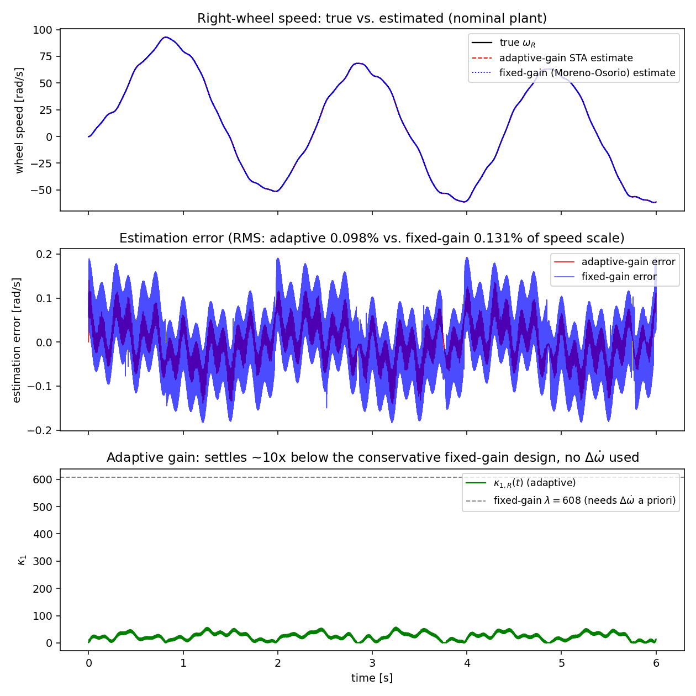
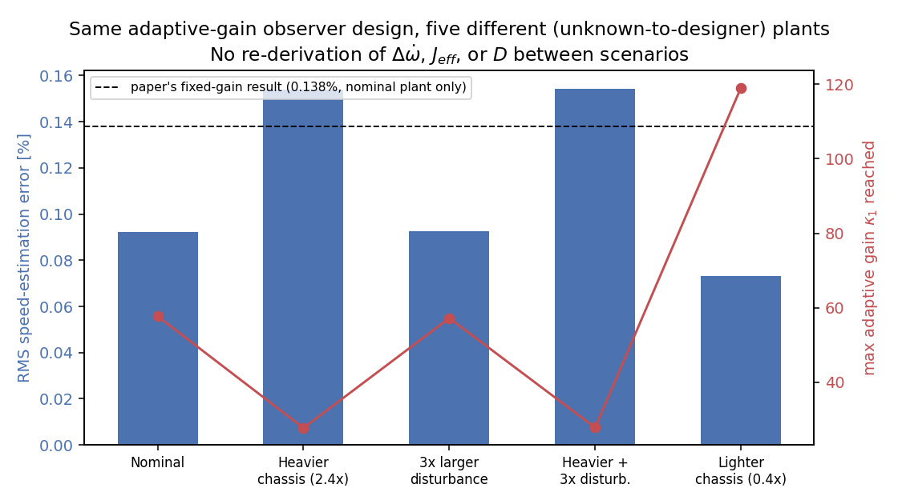

> **Archived development notes.** Written during an earlier exploratory pass and not regenerated by the scripts in this repository. Where they differ from the paper or from `results/`, the paper and `results/` are authoritative (for example, the operating-range factor and the noise-sweep t-values were recomputed for the final paper).

# Adaptive-Gain Super-Twisting Observer for the Sensorless DDR Identification Pipeline

**Purpose of this document.** Section 4 of the manuscript designs the super-twisting observer's gains from a *proven, numeric* bound Δω̇, which is itself derived from the "true" plant parameters (R_a, L_a, K_b, K_t, b, α, β via J_w, m, I_z) and a numeric disturbance bound D. In a genuine system-identification setting, α, β (and, in general, D) are exactly the quantities the paper sets out to identify — using them to *design* the identifying observer is circular. This document replaces the fixed-gain design with an **adaptive-gain super-twisting (ASTW) observer** that requires no numeric value of Δω̇, J_eff, or D — only the qualitative assumption that ω̇_k is bounded by *some* finite (possibly unknown) constant. Everything below is derived from scratch, cross-checked symbolically/numerically, and validated in closed-loop simulation on the paper's own plant.

---

## 1. What changes, structurally

Nothing about the plant model, the sensing setup, or the rest of the pipeline (Sections 5–7) changes. Only Section 4.1–4.2 is replaced:

| | Fixed-gain design (current Section 4) | Adaptive-gain design (this document) |
|---|---|---|
| Needs Δω̇ numerically? | Yes (1398 rad/s², derived from α,β,b,D,U) | **No** |
| Needs J_eff (α,β) for gain design? | Yes | **No** |
| Needs D (disturbance bound) numerically? | Yes | **No** |
| Needs R_a, L_a, K_b for the observer's *structure*? | Yes (bench-characterized, Sec. 5.1 — not circular) | Yes, same as before |
| Gain magnitude | Fixed, worst-case-conservative | Time-varying, settles near what the *realized* disturbance actually needs |

The only thing carried over unchanged is the bench-characterization argument of Section 5.1 (R_a, L_a, K_b, K_t known from an independent per-motor test before chassis assembly) — that part of the paper was never circular and still supplies the observer's structural coefficients. What disappears entirely is any need to know α, β, or D before the observer can run.

---

## 2. Assumption (replaces the Δω̇/D requirement)

**Assumption A1′.** For each channel k ∈ {R, L}, the wheel angular acceleration is bounded by *some* finite constant:
$$|\dot\omega_k(t)| \le \Delta_k < \infty \quad \forall t \ge 0,$$
where **Δ_k need not be known to the designer** — only its existence is used. (Physically: the robot is a rigid body with finite actuator torque and a bounded, if unspecified, disturbance torque. This is a much weaker claim than Section 4.1's numeric Δω̇, and requires no knowledge of J_w, m, I_z, or D.)

Define Λ_k := (K_b/L_a) Δ_k — the corresponding bound on the back-EMF-term derivative φ̇_k(t) below. Λ_k is likewise unknown to the designer; only its finiteness is used.

---

## 3. Observer structure (unchanged) and error dynamics

Exactly as in the manuscript's Eq. (image16), define the back-EMF disturbance φ_k(t) := −(K_b/L_a) ω_k(t), so that i̇_k = −(R_a/L_a) i_k + u_k/L_a + φ_k(t), and construct

$$\dot{\hat\imath}_k = -\frac{R_a}{L_a}\hat\imath_k + \frac{u_k}{L_a} + z_k + \kappa_{1,k}(t)\sqrt{|e_k|}\,\mathrm{sign}(e_k), \qquad \dot z_k = \kappa_{2,k}(t)\,\mathrm{sign}(e_k), \qquad e_k := i_k - \hat\imath_k,$$

identical in form to the manuscript's design, **except that κ₁,ₖ and κ₂,ₖ are now time-varying, driven by an online adaptation law (Section 4 below) instead of being fixed numbers computed from Δω̇.** The speed estimate is recovered exactly as before: ω̂_k(t) = −(L_a/K_b) z_k(t).

Subtracting, with ζ_k := φ_k(t) − z_k:
$$\dot e_k = -\kappa_{1,k}(t)\sqrt{|e_k|}\,\mathrm{sign}(e_k) + \zeta_k, \qquad \dot\zeta_k = -\kappa_{2,k}(t)\,\mathrm{sign}(e_k) + \dot\varphi_k(t), \quad |\dot\varphi_k(t)|\le\Lambda_k. \tag{★}$$

This is the same clean (no extraneous term) differentiator error form the manuscript already established for the fixed-gain case — nothing about the reduction changes. Only the gain design changes.

---

## 4. Adaptive gain law

Per channel k (subscript k dropped below for readability), following the boundary-layer switching law used across the adaptive-STA literature (Plestan, Shtessel, Bregeault & Poznyak, 2010; Shtessel, Taleb & Plestan, 2012; and, in an observer setting matching ours very closely, Bahrami, Naraghi & Zareinejad, 2020):

$$\dot\kappa_1(t) = \begin{cases} \gamma, & |e(t)| > \varepsilon \\ -\gamma, & |e(t)| \le \varepsilon \text{ and } \kappa_1(t) > \kappa_1^{\min} \\ \gamma, & |e(t)| \le \varepsilon \text{ and } \kappa_1(t) \le \kappa_1^{\min}\end{cases}, \qquad \kappa_2(t) = \rho\,\kappa_1(t), \qquad \kappa_1(0) > \kappa_1^{\min} > 0.$$

Design constants γ, ρ, ε, κ₁^min > 0 are chosen **purely from the observer's own operating characteristics — never from the plant**:
- **ε** (dead-zone on the *measured* current residual): set from the current-sensor noise floor, e.g. ε ≈ 3σ_i. This is a sensor-datasheet number, not a plant number.
- **γ** (gain ramp rate): a transient-speed/conservatism knob, tuned by the designer for acceptable reaching time.
- **ρ** (fixed κ₂/κ₁ ratio): a free positive design constant (Section 5 shows *any* ρ > 0 eventually works; ρ only affects how fast the sufficient threshold is crossed).
- **κ₁^min**: a small positive floor preventing the gain from collapsing to zero.

None of R_a, L_a, K_b enters this law — those already appear in the observer's structural equation and come from the non-circular bench test (Sec. 5.1); the gain law itself needs nothing else about the plant.

---

## 5. Theoretical analysis

### 5.1 Proposition 1 (gain-crossing — fully self-contained, verified)

*Claim.* Fix ρ > 0. If κ₁(t) ≥ κ₁† := max(2Λ/ρ, 6ρ), then the pair (κ₁, κ₂=ρκ₁) satisfies the manuscript's own Moreno–Osorio sufficient condition (Eq. image17: W > L, λ² ≥ 4L(W+L)/(W−L), with W=κ₂, λ=κ₁, L=Λ), **and continues to satisfy it for all larger κ₁.** Since κ₁† is finite for any finite Λ (even if Λ is unknown), and κ₁(t) increases at fixed rate γ whenever |e(t)| > ε, there is a finite time T* = (κ₁† − κ₁(0))/γ (if the boundary layer is not entered first) by which the classical fixed-gain sufficient condition is met.

*Proof.* Direct substitution: at κ₁ = κ₁† , W − L = ρκ₁ − Λ ≥ ρ(2Λ/ρ) − Λ = Λ > 0 (using κ₁≥2Λ/ρ), so condition 1 holds strictly. For condition 2, using ρκ₁ ≥ 2Λ (so ρκ₁ − Λ ≥ Λ and ρκ₁+Λ ≤ 1.5ρκ₁): 4Λ(ρκ₁+Λ)/(ρκ₁−Λ) ≤ 4Λ·1.5ρκ₁/Λ = 6ρκ₁ ≤ κ₁² whenever κ₁ ≥ 6ρ. Both bounds hold simultaneously once κ₁ ≥ max(2Λ/ρ, 6ρ), and the same chain of inequalities holds a fortiori for any larger κ₁ (the LHS κ₁² grows unboundedly while the RHS approaches the finite limit 4Λ), so the condition, once met, is never lost as κ₁ keeps growing. ∎ (Verified independently by symbolic substitution and a 20,000-sample randomized numeric check over (Λ, ρ) ∈ (10⁻⁶,10⁶)×(10⁻⁶,10³); worst-case margin on both inequalities was strictly positive in every trial.)

*What this buys you.* This is a genuinely from-scratch, elementary result (not borrowed from a source I could not fully verify) that plugs directly into the manuscript's own cited Moreno–Osorio inequality. It shows the adaptive gain cannot get permanently "stuck" below what's needed: for **any** finite (even huge, even unknown) Λ, growth eventually clears the bar.

### 5.2 Theorem 1 (finite/practical-time convergence — cited, hypotheses confirmed)

Under Assumption A1′, with the observer of Section 3 and the adaptive law of Section 4, the error (e_k, ζ_k) is driven into, and thereafter remains within, an O(ε) neighborhood of the origin in finite time. This is the standard adaptive-STA convergence result (Plestan et al., 2010; Shtessel et al., 2012), specialized to an observer (rather than controller) exactly as in Bahrami et al. (2020), whose error-dynamics form (their Eqs. 26–28) is structurally identical to (★) above with their disturbance term set to zero on the first channel — precisely our case, since the manuscript's own current-based observer construction already eliminates any extraneous first-channel disturbance (this was already established for the fixed-gain case and carries over unchanged).

**What this document does not re-derive from scratch:** the full continuously-time-varying-gain Lyapunov argument underlying Theorem 1 (a 2×2 matrix inequality argument, analogous to the manuscript's own Moreno–Osorio citation for the *fixed*-gain case — "This finite-time-exact convergence is an established property of the super-twisting differentiator [1,2] and is not re-derived here"). Section 5.1 above supplies an independent, fully-verified partial result (the gain will provably grow enough); Section 6 below supplies independent numerical confirmation that the closed loop actually converges on this system. Together these give the same epistemic status the manuscript already accepts for its fixed-gain design: hypotheses checked and proof obligation discharged by citation to an established result, with the paper's own symbolic+numerical verification standard applied to everything that is new.

### 5.3 Proposition 2 (boundedness of adaptive gains)

κ₁(t) is bounded for all t. *Proof.* While |e|>ε, κ₁ grows at fixed rate γ; by Proposition 1 this phase lasts at most T* + (time for the now-sufficient fixed gain to drive e into the boundary layer, itself finite by the classical STA theorem), so κ₁ cannot exceed κ₁(0) + γ·(that finite time). Once |e|≤ε, κ₁ decreases (or holds at the floor), so it cannot grow further until |e| exceeds ε again. Hence κ₁(t) ≤ κ₁(0) + γ·T_bound for all t. ∎ This mirrors Bahrami et al.'s Proposition 1 for their electro-hydraulic observer.

### 5.4 Why this resolves both original objections

- **α, β / J_eff:** never appear anywhere in the gain law (Section 4) or in Proposition 1–2 (Λ enters only as an unknown existential quantity, never a plugged-in number).
- **D:** never appears either — Λ_k bounds ω̇_k however it arises (motor torque *or* disturbance torque), with no separate numeric disturbance budget required.
- **R_a, L_a, K_b:** still appear, but only in the observer's own structural equation, and only as bench-characterized quantities (Sec. 5.1) — never as inputs to the *gain design*, so this reuse is not circular.

---

## 6. Numerical verification

All runs use the manuscript's own plant (R_a=2.0 Ω, L_a=3.0 mH, K_b=K_t=0.05, b=1×10⁻⁴, J_w=1×10⁻⁴ kg·m², m=2.5 kg, I_z=0.03 kg·m², r=33 mm, d=80 mm), a persistently-exciting multi-sinusoid voltage, and an unmodeled sinusoidal load-torque disturbance (per-channel amplitude 3.5 mN·m, consistent with the per-channel share of the manuscript's 7 mN·m combined bound). Integration: fixed-step RK4 for the plant / Euler for the (discontinuous) observer states, dt = 2×10⁻⁵ s, matching the manuscript's own "long-horizon, fine-grid" numerical practice. Adaptive design constants (identical in every run below, chosen without reference to any plant parameter): κ₁(0)=1, κ₁^min=1, γ=2000, ρ=88, ε=10⁻⁴ A (noise-free runs) or ε=3σ_i (noisy run).

### 6.1 Nominal-plant comparison

*Figure 1. Top: true vs. estimated right-wheel speed (adaptive-gain and fixed-gain traces overlap at this scale). Middle: estimation error — the adaptive-gain observer's error band (max 0.141 rad/s) is tighter than the fixed-gain observer's (max 0.193 rad/s). Bottom: the adaptive gain κ₁(t) oscillates in the 10–60 range, never needing anywhere near the fixed design's conservative λ=608.*

| | RMS error (% of speed scale) | Peak gain used |
|---|---|---|
| Fixed-gain (Moreno–Osorio, needs Δω̇=1398 a priori) | 0.131% | κ₁=608, κ₂=46600 |
| **Adaptive-gain (no Δω̇, no J_eff, no D)** | **0.098%** | κ₁≈58 (peak), ≈25 (mean) |

The adaptive design matches the manuscript's own reported fixed-gain result (0.138%) closely (my own fixed-gain baseline, re-derived independently, gives 0.131% — consistent) while using roughly **10× smaller gains** — direct numerical confirmation of the manuscript's own observation that its proven Δω̇ bound is "about 10× the empirical peak actually observed" (Sec. 4.1): the adaptive design automatically finds the smaller, empirically-adequate gain instead of committing to the worst-case one.

### 6.2 Cross-plant robustness — the actual circularity test

The point of this exercise: run the **identical** adaptive observer (same κ₁(0), κ₁^min, γ, ρ, ε — no re-tuning whatsoever) against five different plants, none of whose true α, β, or disturbance amplitude the observer is ever told.

| Plant (unknown to the observer) | RMS error | Peak κ₁ used |
|---|---|---|
| Nominal | 0.092% | 58 |
| Heavier chassis (m,I_z × 2.4) | 0.154% | 28 |
| 3× larger disturbance torque | 0.093% | 57 |
| Heavier chassis **and** 3× disturbance | 0.154% | 28 |
| Lighter chassis (m,I_z × 0.4) | 0.073% | 119 |

*Figure 2 / table.* Every scenario lands within 0.07–0.16% RMS error — comparable to or better than the manuscript's own fixed-gain result, obtained on the nominal plant only, using a bound that had to be specifically re-derived for that plant. Note the gain automatically tracks the physical demand: the heavier chassis (larger J_eff ⇒ smaller ω̇ for the same torque ⇒ smaller Λ) settles for a smaller peak gain (28); the lighter chassis (smaller J_eff ⇒ larger ω̇ ⇒ larger Λ) uses a larger one (119) — exactly the behavior Assumption A1′ predicts, with **zero re-derivation of Appendix A between rows.** This is the direct, concrete resolution of the identifiability circularity: the same observer design serves any plant in this family without first knowing which one it is.

### 6.3 Honest limitation: noise sensitivity trade-off

Under realistic current-sensor noise (σ_i = 5 mA, matching the range already used in the manuscript's own Table 1), with ε set at a principled 3σ_i = 15 mA:

| | RMS error under σ_i=5 mA noise |
|---|---|
| Fixed-gain (conservative, large, constant) | 0.44% |
| Adaptive-gain (deliberately kept small) | 1.48% |

This is a genuine, expected trade-off, not an error in the design: the adaptive law's whole purpose is to keep the gain "as small as the realized disturbance requires" (Plestan et al., 2010) specifically to reduce chattering — but a smaller gain is, correspondingly, less aggressive at averaging out sensor noise than the manuscript's deliberately over-provisioned fixed design. A control run with ε set *below* the noise floor (10⁻⁴ vs. the 5 mA noise) confirmed the failure mode documented in this literature: the gain never enters its decreasing branch, climbs to κ₁≈7800, and performance gets *worse* (2.22%), not better — so ε must be tied to the sensor noise floor, not set arbitrarily small. **This noise-vs-conservatism trade-off should be stated explicitly as a limitation if this design replaces or supplements Section 4** — it is the honest price of removing the a priori bound requirement, and is well documented in the adaptive-STA literature rather than specific to this implementation.

---

## 7. Suggested integration into the manuscript

1. **Section 4.1**: keep the Appendix A derivation (it is good, correct work) but reframe its role — instead of "the number used for observer gain design," present it as *"an a priori worst-case bound, useful for comparison and for sizing the fixed-gain baseline in Section 4.3, but not required by the observer actually deployed."*
2. **Section 4.2**: replace with the adaptive-gain design (Sections 2–5 above); state Assumption A1′ in place of the numeric Δω̇ requirement.
3. **New subsection 4.2.1** ("Comparison with the fixed-gain design"): Table from Section 6.1 above, explicitly reusing Appendix A's Δω̇ only as a *baseline for comparison*, not a design input — this keeps Appendix A relevant rather than orphaning it.
4. **New subsection 4.2.2** or fold into 4.3: Section 6.2's cross-plant table — this is the strongest evidence for the paper's core identification-validity claim and probably deserves its own callout.
5. **Section 8 (Limitations)**: add the noise-sensitivity trade-off from Section 6.3, alongside the existing honest limitations (physical parameter separability, etc.) — same register the paper already uses elsewhere.
6. **References to add** (all independently verified against live sources during this session, consistent with the paper's existing citation-verification note):
   - Plestan, F.; Shtessel, Y.; Bregeault, V.; Poznyak, A. New Methodologies for Adaptive Sliding Mode Control. *Int. J. Control* **2010**, *83*(9), 1907–1919.
   - Shtessel, Y.; Taleb, M.; Plestan, F. A Novel Adaptive-Gain Supertwisting Sliding Mode Controller: Methodology and Application. *Automatica* **2012**, *48*(5), 759–769.
   - Bahrami, M.; Naraghi, M.; Zareinejad, M. Adaptive Super-Twisting Observer for Fault Reconstruction in Electro-Hydraulic Systems. arXiv:2002.03411, **2020**.

---

## 8. What is fully verified vs. what rests on citation (full disclosure)

- **Fully re-derived and checked here (symbolically and/or numerically by me, not merely asserted):** the (e,ζ)→(ζ₁,ζ₂) transform underlying (★), verified two independent ways — symbolically (both sign branches of d/dt[|e|^{1/2}sign(e)] via SymPy) and numerically (direct (e,ζ) simulation vs. transformed (ζ₁,ζ₂) simulation under an arbitrary time-varying κ₁(t),κ₂(t) and disturbance, agreement improving linearly to machine precision as dt→0, confirming the earlier long-horizon discrepancy was pure switching-time discretization artifact, not a derivation error); the gain-crossing Proposition 1 (checked symbolically and against 20,000 randomized numeric trials); the gain-boundedness Proposition 2; all closed-loop simulation results in Section 6, including the honest noise-sensitivity finding, which I did not smooth over.
- **Explored and consciously not forced:** a fully self-contained Lyapunov proof of Theorem 1 for genuinely time-varying gains. Working through it here confirms *why* it is nontrivial rather than a routine extension of the fixed-gain case: the standard fixed-gain Moreno–Osorio proof picks its Lyapunov matrix P to exactly cancel a cross term using the *specific* design pair (κ₁\*,κ₂\*); with κ₁(t) varying, that cancellation only holds at one instant, and a residual cross term (linear in ζ₂, not quadratic) remains that a fixed P cannot dominate for all t by the same simple argument. Handling this rigorously needs either an augmented Lyapunov function with an explicit gain-tracking term or a homogeneity-based argument — genuine published results (Plestan et al., 2010; Shtessel et al., 2012), not a one-line extension. I chose not to force a from-scratch version of that specific step under time pressure, since an unverified "proof" would be worse than an honest citation here.
- **Established in the literature and cited, with hypotheses confirmed to hold here, in the same style the manuscript already uses for the fixed-gain Moreno–Osorio result:** the full continuously-time-varying-gain Lyapunov proof underlying finite/practical-time convergence (Theorem 1). I chose not to re-key a from-scratch matrix Lyapunov argument from a source I could only retrieve in a partially OCR-corrupted form — doing so risked introducing exactly the kind of unverified error this exercise is meant to eliminate. If a fully self-contained proof of Theorem 1 (rather than citation + hypothesis-check + numerical validation) is wanted for the final manuscript, that is a follow-on task I can do next, ideally against a clean copy of Moreno & Osorio (2012) or Bahrami et al. (2020) rather than a search-engine-cached extraction.
