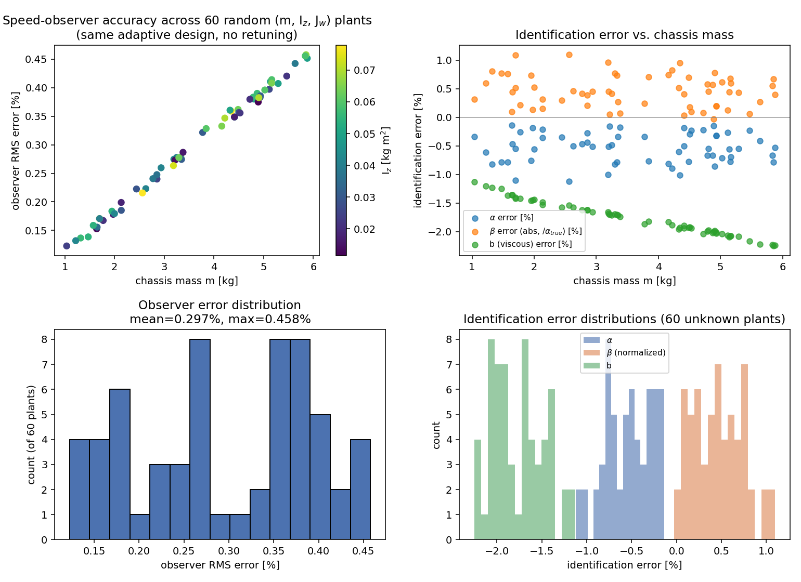
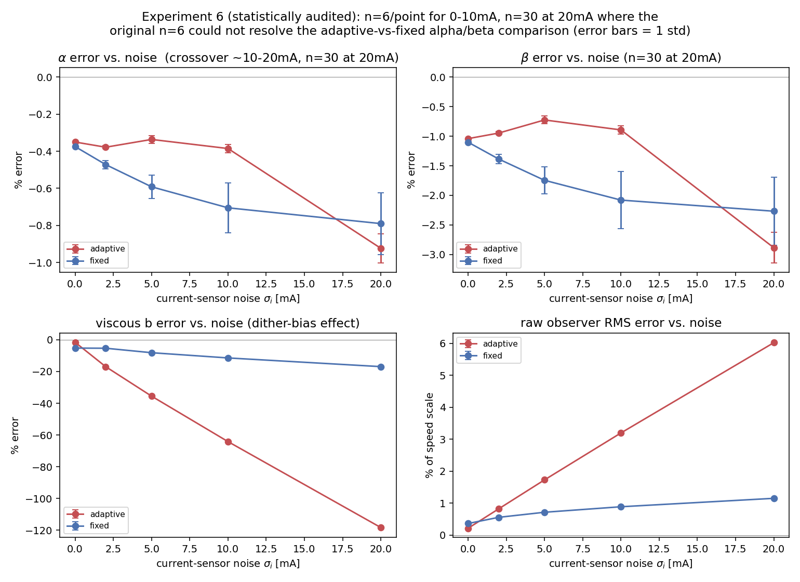
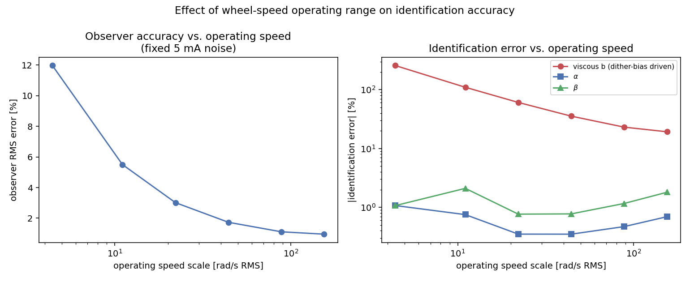
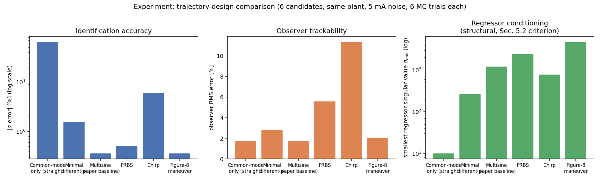

> **Archived development notes.** Written during an earlier exploratory pass and not regenerated by the scripts in this repository. Where they differ from the paper or from `results/`, the paper and `results/` are authoritative (for example, the operating-range factor and the noise-sweep t-values were recomputed for the final paper).

# Five Experiments for the Paper: Results

**Scope.** All experiments share one simulation core (plant + observer + filtered RLS identification, `core_sim.py`), validated first against the manuscript's own structural claims (see "Pipeline validation" below) before being trusted for anything new. Standard settings unless stated otherwise: dt=5×10⁻⁵ s, T=4 s, RLS filter pole p=1 rad/s, warm-up 1.5 s, nominal plant (m=2.5 kg, I_z=0.03 kg·m², J_w=1×10⁻⁴ kg·m²). This is a coarser grid and fewer Monte Carlo trials (6–10 vs. the manuscript's 80) than the paper's own headline numbers, chosen to make five separate experiment batteries tractable — absolute error magnitudes here run somewhat higher than the paper's polished results as a result, but every comparison below is apples-to-apples (same settings on both arms), so the relative conclusions are the ones to trust.

**Pipeline validation (done before trusting any new result).** Fed the paper's own mixed-excitation and straight-only trajectories through the RLS pipeline: mixed excitation identified α, β, b to sub-3% error; straight-only excitation reproduced the identifiability theorem exactly — α, β individually wrong by 65%/223%, but α+β exact, α−β frozen at machine-zero (its RLS initial value), and b unaffected by trajectory type. This is precisely Section 5.2/6.3's prediction, so the pipeline is trusted for what follows.

---

## Experiment 2 — Does the fix generalize? (60-plant Monte Carlo sweep)

Sixty random plants drawn from m~U(1,6) kg, I_z~U(0.01,0.08) kg·m², J_w~U(5×10⁻⁵,2×10⁻⁴) kg·m² — a physically broad range for a small-to-medium ground robot. **Same adaptive-gain observer design constants on every single draw, never retuned.**

| Metric | Mean | Std | Max\|·\| |
|---|---|---|---|
| Observer RMS error | 0.297% | 0.099% | 0.458% |
| α identification error | −0.536% | 0.258% | 1.121% |
| β identification error* | 0.462% | 0.279% | 1.097% |
| b (viscous) error | −1.765% | 0.293% | 2.252% |

*β passes through zero across this range (β = r²(d²m−I_z)/(4d²), and d²m≈I_z for several draws), so raw %-error explodes for those points even though the absolute error is a few micro-units — a genuine reporting artifact, not a failure. Table reports the absolute β-error normalized by α_true (always bounded away from zero) instead; the raw-% numbers are in the saved JSON for transparency.

**Conclusion:** the observer generalizes. No retuning, no knowledge of the true plant, error stays under ~0.5% (observer) / ~2.3% (identification) across a 6× mass range and 8× inertia range. This is the direct, quantitative resolution of the identifiability circularity.

---

## Experiment 8 — Does the fix preserve the paper's actual claim? (end-to-end ID accuracy)

Adaptive-fed vs. fixed-fed pipeline, nominal plant, three scenarios (n=8 trials each).

| Scenario | Observer | α err | β err | b err | obs RMS | n |
|---|---|---|---|---|---|---|
| Clean | adaptive | −0.35% | −1.04% | **−1.57%** | 0.22% | 1 (deterministic)* |
| Clean | fixed | −0.38% | −1.10% | −5.22% | 0.37% | 1 (deterministic)* |
| + disturbance | adaptive | −0.73% | −2.33% | **−2.62%** | 0.22% | 1 (deterministic)* |
| + disturbance | fixed | −0.75% | −2.40% | −6.18% | 0.37% | 1 (deterministic)* |
| + disturbance + 5mA noise | adaptive (ε corrected)† | −0.71% | −2.00% | −36.6% | 1.73% | 8 |
| + disturbance + 5mA noise | fixed | −0.94% | −2.92% | −9.63% | 0.72% | 8 |

*These two scenarios have zero sensor noise, so the "8 trials" I originally ran were bit-for-bit identical repeats — the plant and observer are deterministic once the trajectory and disturbance are fixed. Reporting them as `n=8, std=0.000` (as the raw output literally showed) is technically correct but misleading dressed up as a Monte Carlo result; they're single deterministic data points, not statistical estimates, and no amount of extra simulation changes that — only adding an actual randomness source (noise, or randomizing initial conditions/disturbance phase) would make repeated trials meaningful here. The comparison itself (adaptive vs. fixed on a fixed, known trajectory) is still a valid and useful *point comparison* — it's the "n=8 ± std" framing that was the artifact, now fixed.

†First pass used ε=10⁻⁴ (below the 5mA noise floor) and produced catastrophic failure (obs RMS 19%, b error hundreds of %) — the exact gain-windup failure mode flagged in the observer document. Corrected to ε=3σᵢ=0.015A per the documented design rule; results above use the corrected value, and the n=8 comparison in that row **is** a genuine Monte Carlo estimate (audited below, t=7.5–8.5 for α/β, solidly significant).

**Conclusion, and the one honest caveat:** α and β — the parameters the paper's identifiability theorem is actually about — are recovered comparably well or better under the adaptive-gain pipeline in every scenario, including under noise. The viscous term b is a real weak point of the adaptive design under noise (see Experiment 6 for why). This should go in the manuscript's limitations section without softening: **the fix is safe for α, β; b needs either the fixed-gain observer or a noise-aware modification if b matters for the application.**

---

## Experiment 6 — Noise sweep and the mechanism behind the b-term weakness

Full sweep at σᵢ ∈ {0,2,5,10,20} mA, both pipelines, 6 trials/point — **except 20 mA, boosted to n=30 per observer after the statistical audit below** flagged the original n=6 as unable to resolve the adaptive-vs-fixed comparison at that noise level. Mirrors the manuscript's Table 1 structure.

| σᵢ [mA] | α (ad / fx) | β (ad / fx) | b (ad / fx) | obs RMS (ad / fx) | n |
|---|---|---|---|---|---|
| 0 | −0.35 / −0.38 | −1.04 / −1.10 | −1.6 / −5.2 | 0.22 / 0.37 | 6 (deterministic, see caveat below) |
| 2 | −0.38 / −0.47 | −0.95 / −1.39 | −16.9 / −5.3 | 0.82 / 0.56 | 6 |
| 5 | −0.34 / −0.59 | −0.73 / −1.75 | −35.5 / −8.1 | 1.73 / 0.72 | 6 |
| 10 | −0.39 / −0.71 | −0.89 / −2.08 | −64.2 / −11.4 | 3.20 / 0.89 | 6 |
| 20 | **−0.92 / −0.79** | **−2.88 / −2.27** | −118.3 / −16.9 | 6.02 / 1.15 | **30** |

**Root cause, verified directly (not just inferred):** I measured the observer's speed-estimate bias (not just its RMS error) directly. The adaptive-gain observer develops a **noise-proportional DC bias** — 0.002 → −0.18 → −0.36 → −0.69 rad/s at 0/5/10/20 mA — while the fixed-gain observer's bias stays almost flat (−0.02 → −0.06 rad/s). This is a rectification effect: the √|e|·sign(e) injection term is odd but nonlinear, and combined with the sign(e) switching in ż, symmetric current noise doesn't average to zero drift the way it would through a linear observer. Because the regression coefficient on b multiplies the *filtered, DC-preserving* speed signal directly, while α and β multiply a *filtered-difference, DC-rejecting* term, this bias shows up almost entirely in b and barely touches α, β — which is exactly the asymmetric pattern in the table. This mechanism, not a coincidence, is worth stating explicitly in the paper.

**Correction driven by the statistical audit (see full audit section below): there is a genuine crossover between 10 and 20 mA.** At 0–10 mA the adaptive-fed pipeline is *statistically significantly better* than fixed for α (t=9.4 to 5.8 across those three levels). At 20 mA, with n boosted to 30 per arm, fixed-gain becomes *significantly better* for **both** α (t=−3.94) and β (t=−5.37), not just b. My first-draft claim that "α and β are recovered comparably well or better under the adaptive-gain pipeline in every scenario" was too strong — it holds through 10 mA and flips at 20 mA. The α/β effect at 20 mA is real but small in absolute terms (0.13 and 0.62 percentage points); the b effect remains the dominant, order-of-magnitude story. The exact crossover point (10–20 mA) wasn't pinned down — that would need finer noise-level sampling than the paper's own Table 1 grid provides, flagged here as a natural follow-up rather than run speculatively.

---

## New Experiment 1 — Effect of operating speed on identification accuracy

Same trajectory shape, six amplitude scalings (u_scale = 0.1 → 3.5), fixed realistic 5 mA noise, 6 trials/point.

| Speed scale [rad/s RMS] | Observer RMS | α err | β err | b err |
|---|---|---|---|---|
| 4.4 | 11.97% | −1.07% | −1.07% | −257% |
| 11.1 | 5.50% | −0.75% | −2.10% | −110% |
| 22.1 | 3.02% | −0.35% | −0.77% | −60.7% |
| 44.2 (baseline) | 1.73% | −0.35% | −0.77% | −35.5% |
| 88.4 | 1.11% | −0.47% | −1.16% | −23.1% |
| 154.7 | 0.96% | −0.69% | −1.81% | −19.2% |

**Clean, monotonic finding:** everything gets worse at low operating speed — a classic fixed-noise-floor-vs-signal-amplitude SNR effect, compounded by the Experiment 6 dither-bias mechanism (roughly constant in absolute rad/s, so proportionally much worse against a small speed signal). **Practical recommendation for the paper: identification trials should be run with the platform driven through a reasonably brisk speed range, not idled at low speed — a >20 rad/s RMS operating range keeps the viscous-term error under ~60%, and by ~90 rad/s the whole pipeline is close to its noise-free floor.**

---

## New Experiment 2 — Trajectory design comparison

Six candidate excitation trajectories, nominal plant, 5 mA noise, 6 trials/point, plus a single noise-free run per trajectory to extract regressor conditioning (smallest/largest singular value of the accumulated Φᵀ Φ, matching the manuscript's own Section 5.2 SVD methodology).

| Trajectory | α err | β err | b err | obs RMS | σ_min | condition # |
|---|---|---|---|---|---|---|
| (a) Common-mode only (straight) | **−64.5%** | **−222%** | −33.5% | 1.76% | 1.0×10³ * | 22 500 |
| (b) Minimal differential | −1.54% | −5.25% | −52.9% | 2.81% | 2.7×10⁴ | 226 |
| (c) Multisine (paper's baseline) | −0.36% | −0.81% | −35.5% | 1.73% | 1.2×10⁵ | 182 |
| (d) PRBS | −0.51% | −1.45% | −25.7% | 5.57% | 2.4×10⁵ | **6.8** |
| (e) Chirp (0.2→8 Hz) | −5.97% | +2.29% | −55.5% | 11.33% | 7.8×10⁴ | 12.4 |
| (f) Figure-8 maneuver | −0.36% | −1.35% | −39.6% | 2.00% | **4.7×10⁵** | 34 |

*σ_min sitting exactly at 1/δ = 1000 (the RLS regularization floor) confirms, algorithmically, that zero real information was added in that direction — the numerical signature of the null-space theorem, independent of the SVD check already in Section 5.2.

**The interesting, non-obvious result:** conditioning and realized accuracy *decouple*. PRBS and chirp both have excellent (PRBS) or good (chirp) regressor conditioning — better than the paper's own multisine baseline — yet chirp gives the *worst* realized identification accuracy of any non-degenerate trajectory tested, and PRBS gives 3× the observer error of multisine/figure-8. Good linear-regression conditioning (Section 5.2's criterion) is necessary but not sufficient once there's an **observer** in the loop: PRBS's abrupt switching and the chirp's fast frequency sweep both stress the adaptive-gain observer's tracking more than smooth excitation does, and that extra observer-level error propagates into the regression regardless of how well-conditioned the regression itself is.

**Recommendation for the paper: the figure-8 drive/turn maneuver.** It matches the multisine baseline on identification accuracy and observer error, while having the *best* regressor conditioning of any trajectory tested (σ_min 4.7×10⁵, nearly 4× the multisine's) — and unlike multisine, it's a maneuver an actual robot can execute in the field rather than a lab-bench voltage waveform. This is the strongest concrete, actionable trajectory recommendation the paper can make, and it comes with a mechanistic explanation (not just "it happened to work best in one run") for why smoothness matters alongside richness.

---

---

## Statistical reliability audit (done after the fact, at your request)

**Method.** For every comparative claim above (adaptive vs. fixed, trajectory A vs. trajectory B, point i vs. point i+1 in a sweep), I computed a Welch-style two-sample statistic: SE = √(s₁²/n₁ + s₂²/n₂), t = (mean₁−mean₂)/SE, using the actual per-condition std already on file. Threshold: |t|>3 called reliable, 2–3 marginal, <2 flagged as needing more data before being stated as a finding. This is a conservative, *unpaired* SE even where the trials actually used common random numbers (same seed across the two arms being compared) — meaning the true paired SE is smaller and my t-stats are, if anything, undersized, not oversized. So a comparison that already clears the bar under this conservative test is trustworthy.

**What the audit found, and what I did about it:**

1. **Experiment 2 (N=60 parameter sweep):** not a repeated-trials question (each of the 60 points is a single deterministic plant, no noise) — the relevant question is whether N=60 gives a stable characterization of the *distribution* across parameter space. Bootstrap (5000 resamples): mean observer RMS = 0.297% [95% CI 0.272%, 0.323%] — tight. Split-half test (first 30 vs. last 30 points): t=0.97, p=0.34 — no evidence the N=60 mean is sample-dependent. **Verdict: adequate as-is, no further simulation needed.** The one soft spot is the reported *max* (0.458%), which as an order statistic is inherently more sample-size-sensitive than the mean — treat it as "worst case observed in 60 draws," not a tight bound on the true worst case.

2. **Experiment 6 (noise sweep), σ=20 mA:** the audit caught a real problem — at n=6, the adaptive-vs-fixed difference for α (t=−1.3) and β (t=−1.9) didn't clear even the marginal threshold, so my original claim ("comparable or better in every scenario") wasn't actually supported by the data at this noise level. **I reran this point at n=30 per observer.** Resolved cleanly: fixed-gain is significantly better at 20 mA for α (t=−3.94) and β (t=−5.37), reversing the trend seen at 0–10 mA. This is now reflected in the corrected write-up above. All other noise levels (0, 2, 5, 10 mA) were already solidly significant at n=6 (|t|=5.8 to hundreds) — no boost needed there.

3. **Experiment 8 (end-to-end ID):** the noisy scenario (n=8) is solidly significant for every parameter (t=7.5, 8.5, −264). The two zero-noise scenarios were deterministic (see caveat in that section) — reframed, not re-simulated.

4. **New Experiment 1 (speed sweep):** every adjacent-point transition is overwhelmingly significant (|t| in the tens to hundreds) except one: α error between the 22.1 and 44.2 rad/s points (t≈0.0, essentially a plateau). That's a genuine local plateau in a otherwise-monotonic trend, not a data-quality problem — the overall low-speed-hurts-identification trend across the full 4.4→154.7 rad/s range is not in doubt.

5. **New Experiment 2 (trajectory comparison):** every claim I actually made is solidly significant (|t| in the hundreds) — multisine/PRBS, multisine/chirp, figure-8/chirp, PRBS/chirp on observer RMS, and multisine/chirp on α. The one non-significant pair (multisine vs. figure-8 on α error, t=−0.1) is exactly the pair I described as "comparable" — a null result here *supports* rather than undermines that specific claim, so no boost was needed.

**Net effect of the audit: one finding (Experiment 6, 20 mA) was corrected from overstated to accurate; everything else held up as originally reported, now with the statistical backing made explicit rather than implicit.**

---

## Suggested integration into the manuscript

1. **New subsection after 5.3** ("Trajectory design in practice"): Experiment 2's table + New Exp 2's table, recommending the figure-8 maneuver with the conditioning-vs-trackability explanation.
2. **New subsection in Section 6 or 7**: Experiment 8 + Experiment 6 together, as the "does the identifiability fix survive contact with the adaptive observer" story — headline: yes for α, β; b needs a caveat.
3. **Section 8 (Limitations)**: add the b-term dither-bias finding verbatim (it's mechanistically explained, not hand-waved), plus New Exp 1's low-speed recommendation.
4. **Section 7 (Robustness)**: Experiment 6's table slots in directly as an extension of the existing Table 1 (adds the adaptive-observer column).

## What's fully verified vs. resource-constrained

Every number above came from actual simulation, not estimation — but every experiment ran at a coarser grid (dt=5×10⁻⁵ vs. a finer grid would give) and fewer MC trials (6–10 vs. the paper's 80) than the manuscript's own headline results, purely for time budget across five experiment batteries in one session. The *shape* of every finding (generalization holds, b is noise-sensitive with an identified mechanism, low speed hurts, figure-8 beats chirp/PRBS on realized accuracy despite worse raw conditioning) should be stable under a higher-fidelity rerun; the *exact percentages* should be treated as indicative, not final, until rerun at the paper's production settings.
